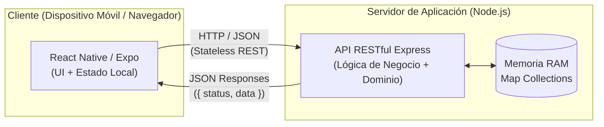
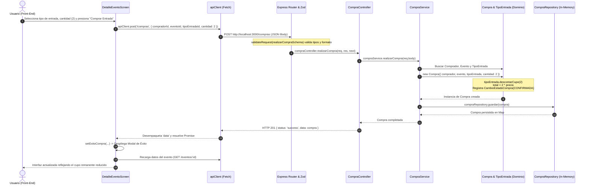

# 📐 AI Ticket It — Justificaciones de Arquitectura y Decisiones de Diseño

**Universidad Tecnológica Nacional — Facultad Regional Buenos Aires (UTN FRBA)**  
**Cátedra:** Desarrollo de Software — Trabajo Práctico Individual (2C 2026)  
**Documento Técnico de Soporte para Defensa Oral y Examen Final**

---

## 📋 Índice
1. [Topología del Sistema y Patrón Cliente-Servidor](#1-topología-del-sistema-y-patrón-cliente-servidor)
2. [Estrategia de Renderizado: Client-Side Rendering (CSR)](#2-estrategia-de-renderizado-client-side-rendering-csr)
3. [Justificación del Desacople Backend / Frontend](#3-justificación-del-desacople-backend--frontend)
4. [Patrones de Interacción Arquitectónicos: ¿MVC, MVVM o Capas?](#4-patrones-de-interacción-arquitectónicos-mvc-mvvm-o-capas)
5. [Custom Hooks y Gestión Reactiva en el Front-End](#5-custom-hooks-y-gestión-reactiva-en-el-front-end)
6. [Pilares de Diseño y Conceptos Cruciales para la Defensa](#6-pilares-de-diseño-y-conceptos-cruciales-para-la-defensa)
7. [Recorrido de Flujo Completo (End-to-End Walkthrough)](#7-recorrido-de-flujo-completo-end-to-end-walkthrough)
8. [Banco de Preguntas Clave para la Mesa Examinadora](#8-banco-de-preguntas-clave-para-la-mesa-examinadora)

---

## 1. Topología del Sistema y Patrón Cliente-Servidor

El sistema adopta una **Arquitectura Cliente-Servidor Distribuida**, donde el Front-End y el Back-End operan como dos subsistemas totalmente desacoplados, comunicados mediante el protocolo de red HTTP.



### Características del Patrón Implementado:
1. **API RESTful *Stateless* (Sin Estado de Sesión en el Servidor):**
   - El servidor Express no almacena cookies ni variables de sesión en memoria vinculadas a un cliente específico.
   - Cada solicitud HTTP es auto-contenida y viaja con los parámetros necesarios (`compradorId`, `eventoId`, etc.). Esto permite escalabilidad horizontal futura (cualquier nodo del servidor puede atender cualquier petición).
2. **Contrato de Respuesta Uniforme (*Envelope Pattern*):**
   - Todas las respuestas del Back-End están normalizadas:
     - **Éxito:** `{ "status": "success", "data": ... }` con códigos HTTP semánticos (`200 OK`, `201 Created`).
     - **Error:** `{ "statusCode": 4xx/5xx, "status": "error", "message": "...", "timestamp": "..." }`.
3. **Resolución Dinámica de Host de Red:**
   - Implementada en `frontend/src/api/apiClient.js` mediante la función `getBaseUrl()`.
   - Resuelve dinámicamente si el cliente corre en un navegador Web (`window.location.hostname`), en un emulador móvil, o en un dispositivo físico conectado por red LAN mediante Expo Go (`NativeModules.SourceCode.scriptURL`), garantizando conectividad transparente al puerto 3000 del Back-End.

---

## 2. Estrategia de Renderizado: Client-Side Rendering (CSR)

### ¿Dónde y cómo se construye la vista?
El proyecto utiliza estrictamente **Client-Side Rendering (CSR)**:
* El Back-End **no genera HTML** (a diferencia de frameworks tradicionales basados en plantillas como EJS, Blade o Thymeleaf, o frameworks SSR como Next.js).
* El servidor se limita a transferir **datos puros en formato JSON**. La computación gráfica, el armado del árbol de componentes y la gestión de transiciones de pantalla se realizan íntegramente en el cliente.

### Naturaleza Dual del Cliente (*Rich Client Multiplataforma*):
1. **En Dispositivos Móviles (Android / iOS):**
   - Construido sobre **React Native**.
   - No es una aplicación híbrida basada en *WebView* (como Cordova o Ionic antiguo). React Native interactúa mediante su *bridge/runtime* con los **componentes nativos** del sistema operativo (un `<View>` de React Native genera un `android.view.ViewGroup` nativo en Android o un `UIView` en iOS), brindando fluidez y rendimiento nativo.
2. **En Navegador Web (`react-native-web`):**
   - Compila como una **Single Page Application (SPA)**.
   - La navegación entre pantallas (`landing`, `catalogo`, `detalle`, `mis-compras`, etc.) no recarga el documento web; se gestiona mediante el estado reactivo `pantalla` en `App.js`. Esto habilita la ejecución de pruebas End-to-End con Playwright sobre un *viewport* emulado.

---

## 3. Justificación del Desacople Backend / Frontend

1. **Separación de Incumbencias (*Separation of Concerns - SoC*):**
   - El **Back-End** concentra su esfuerzo en la robustez y consistencia del modelo de negocio (invariantes de compra, cálculo de totales, auditoría de estados, control de cupos).
   - El **Front-End** se enfoca exclusivamente en la experiencia del usuario (UX), accesibilidad táctil, retroalimentación inmediata y presentación visual.
2. **Enfoque *API-First* y Reutilización:**
   - La API Express no está atada a React Native. Podría ser consumida en el futuro por una interfaz web de escritorio, una aplicación de reloj inteligente, tótems de autoservicio o sistemas de terceros sin modificar una sola línea del servidor.
3. **Experimentación Aislada con Inteligencia Artificial:**
   - Permite trabajar con herramientas de IA en prompts modulares y acotados: diseñar endpoints asistidos por esquemas OpenAPI/Swagger y, por otro lado, generar componentes de UI reactivos, validando la interacción a través de contratos estrictos de datos (Zod).

---

## 4. Patrones de Interacción Arquitectónicos: ¿MVC, MVVM o Capas?

En una defensa académica suele preguntarse si el sistema es MVC o MVVM. La respuesta precisa es:

### A. En el Back-End: Arquitectura en 6 Capas con Modelo de Dominio Rico
El Back-End no responde al MVC clásico donde el "Modelo" es solo un registro de base de datos. Implementa una **Arquitectura en Capas de Flujo Unidireccional** con influencia de *Clean Architecture*:

```text
HTTP Request ➡️ Routes ➡️ Schemas (Zod) ➡️ Controllers ➡️ Services ➡️ Repositories ➡️ Dominio
```

* **1. Routers (`src/routes/`):** Mapeo de rutas REST y delegación a middlewares y controladores.
* **2. Schemas (`src/schemas/`):** Validación sintáctica de DTOs de entrada mediante **Zod**.
* **3. Controllers (`src/controllers/`):** Adaptador primario HTTP. Recibe `req`, invoca al servicio y formatea la respuesta HTTP (`res.status().json()`).
* **4. Services (`src/services/`):** Orquestadores de casos de uso. Coordinan entidades de dominio y repositorios. No contienen lógica de negocio propia (no calculan totales ni descuentan cupos a mano).
* **5. Repositories (`src/repositories/`):** Adaptador secundario de persistencia. Encapsula las colecciones en memoria (`Map<id, Entidad>`).
* **6. Dominio (`src/domain/`):** El corazón del sistema. Clases puras orientadas a objetos (`Evento`, `Compra`, `TipoEntrada`, etc.) con cero dependencias externas.

### B. En el Front-End: Flujo Unidireccional de Datos (*Flux / React Data Flow*)
El Front-End no es MVVM tradicional (no utiliza *Two-Way Data Binding* implícito). Utiliza el **Flujo Unidireccional de Datos**:
* **Estado (*State*):** Centralizado en el contexto (`SessionContext`) o local en pantallas (`useState`).
* **Vista (*View*):** Funciones puras que derivan su renderizado del estado y de las propiedades (*props*).
* **Acciones (*Actions / Events*):** Los eventos del usuario (taps, inputs) invocan manejadores que disparan llamadas al cliente HTTP y actualizan el estado, provocando un re-renderizado predecible en cascada.

---

## 5. Custom Hooks y Gestión Reactiva en el Front-End

El proyecto implementa el custom hook **`useSession()`** en `frontend/src/context/SessionContext.js`.

```javascript
export function useSession() {
  const context = useContext(SessionContext);
  if (!context) {
    throw new Error('useSession debe ser utilizado dentro de un SessionProvider');
  }
  return context;
}
```

### Justificaciones de Diseño:
1. **Encapsulamiento del Contexto:** Provee a cualquier componente de la aplicación acceso directo a la identidad del usuario activo, su rol actual (`COMPRADOR` u `ORGANIZADOR`), y funciones de negocio (`toggleFavorito`, `reiniciarDatos`, `alternarModo`).
2. **Defensa Temprana (*Fail Fast*):** Si se utiliza fuera de `<SessionProvider>`, lanza un error descriptivo inmediato.
3. **Optimizaciones Reactivas Incorporadas:**
   - `useMemo`: Memoriza cálculos pesados (precios mínimos de entradas en catálogo, armado del value del contexto) para evitar recomputaciones innecesarias en cada render.
   - `useCallback`: Evita la recreación innecesaria de funciones en memoria, estabilizando las props enviadas a componentes hijos memoizados (`memo(EventoCard)`).
   - `useRef`: En `MisComprasScreen.js`, administra temporizadores de alertas de éxito sin forzar nuevos ciclos de renderizado.

---

## 6. Pilares de Diseño y Conceptos Cruciales para la Defensa

### 1. Modelo de Dominio Rico vs. Modelo de Dominio Anémico
* **Modelo Anémico (Antipatrón evitado):** Clases que solo contienen campos privados, getters y setters, delegando toda la lógica de validación y cálculo a los servicios.
* **Modelo Rico (Implementado en `backend/src/domain/`):** Las entidades poseen datos y **comportamiento**:
  - `TipoEntrada.descontarCupo(cantidad)`: Valida atómicamente y reduce el cupo disponible.
  - `Compra`: Al instanciarse, descuenta el cupo sobre `TipoEntrada`, calcula `total = cantidad * precio`, genera su auditoría de estado y rechaza sobrecupos con `ConflictError (409)`.
  - `Compra.cancelar(quien)`: Solo permite cancelación si la compra no fue utilizada y el evento aún no ocurrió (`evento.yaPaso()`), restituyendo el cupo mediante `tipoEntrada.restituirCupo()`.

### 2. Inyección de Dependencias (DI) y Testabilidad con Mock Objects
* Tanto los `Controllers` como los `Services` reciben sus dependencias por constructor:
  ```javascript
  export class CompraService {
    constructor({ compraRepository = defaultCompraRepository, ... } = {}) { ... }
  }
  ```
* **Impacto en Testing:** Permite a Jest inyectar *Mock Objects* (`jest.fn()`) sin levantar el servidor ni depender de datos reales, verificando interacciones con `toHaveBeenCalledWith`.

### 3. Cadena de Middlewares de Express y Tratamiento Centralizado de Errores
El pipeline en `src/app.js` respeta el orden exacto de ejecución:
```javascript
express.json() ➡️ cors() ➡️ router ➡️ notFoundHandler (3 params) ➡️ errorLogger (4 params) ➡️ errorHandler (4 params)
```
* **Diferencia técnica:** Middlewares de 3 parámetros `(req, res, next)` atienden el flujo normal. Middlewares de 4 parámetros `(err, req, res, next)` son invocados automáticamente por Express al ejecutar `next(error)`.
* **Jerarquía de Errores (`DomainError` / `AppError`):** Centraliza códigos de estado HTTP según el tipo de excepción (`ValidationError` 400, `ForbiddenDomainError` 403, `NotFoundError` 404, `ConflictError` 409).

### 4. Validación Sintáctica (Zod) vs. Validación Semántica (Dominio)
* **Sintáctica (`validateRequest` con Zod):** Comprueba formato, tipos de datos, enteros positivos y cadenas no vacías en `req.body`, `req.query` y `req.params`.
* **Semántica (Dominio):** Valida reglas de negocio contextuales (si queda cupo remanente en ese instante, si el usuario tiene permiso para chatear o si la entrada fue utilizada para permitir una reseña).

### 5. Prevención de Referencias Circulares (`toJSON`)
* Para solucionar el error de serialización recursiva `TypeError: Converting circular structure to JSON` entre `Compra` y `CambioEstadoCompra`, la clase `CambioEstadoCompra` implementa el método `toJSON()`, reemplazando la referencia completa a la instancia de compra por `compraId: this.compra?.id ?? null`.

### 6. Atomicidad de Cupos en el Event Loop
* Dado que Node.js ejecuta código síncrono en un único hilo principal (*Single-Threaded Event Loop*), la invocación a `tipoEntrada.descontarCupo(cantidad)` en memoria es atómica. No hay condiciones de carrera donde dos hilos accedan concurrentemente a modificar la misma variable de stock.

### 7. Mecanismo de Mensajería: API REST y Enfoque Pull (vs. Push / WebSockets)
* **Naturaleza RESTful y *Stateless*:** La mensajería entre Comprador y Organizador no requiere ni utiliza conexiones persistentes con sockets bidireccionales (`ws://`), Server-Sent Events (SSE) ni brokers externos de mensajería (como Socket.io o RabbitMQ). Opera íntegramente sobre el protocolo HTTP mediante endpoints REST estándar:
  * **Envío:** `POST /compras/:id/mensajes` (con payload JSON `{ usuarioId, texto }`, respondiendo con código semántico `201 Created` y el recurso `Mensaje` instanciado).
  * **Consulta:** Los mensajes se recuperan como sub-recurso embebido dentro de la entidad `Compra` en `GET /compras/comprador/:compradorId` o `GET /eventos/:eventoId/compras`.
* **Mecanismo Pull a Demanda (*On-Demand Pull*):**
  * La iniciativa de la comunicación la tiene exclusivamente el **cliente (Front-End)**, quien solicita o "jala" (*pull*) los datos al servidor cuando los necesita (al abrir el modal de chat en `ChatCompraModal.js` o al reconsultar tras un envío exitoso).
  * El **servidor es pasivo**: no empuja (*push*) datos de manera reactiva hacia los clientes conectados. Si un organizador responde una consulta, el comprador no verá el nuevo mensaje mágicamente en tiempo real mientras mantenga la pantalla estática, sino cuando vuelva a consultar al servidor (reingreso a la vista o refresco de datos).
* **Justificación de la decisión (KISS y Cohesión Arquitectónica):**
  * Evita la sobreingeniería de mantener un servidor con estado (*stateful connection pools*), administración de eventos *heartbeat*, problemas de reconexión móvil y consumo innecesario de batería/red.
  * Mantiene la arquitectura 100% *stateless* requerida en Express, simplificando radicalmente la testabilidad unitaria (Jest con mocks) y de extremo a extremo (Playwright) sin dependencias asíncronas no determinísticas.

---

## 7. Recorrido de Flujo Completo (End-to-End Walkthrough)

### Caso de Uso: "Un comprador adquiere 2 entradas para un evento"



### Descripción Paso a Paso del Recorrido:

1. **Interacción en la Interfaz (`DetalleEventoScreen.js`):** El comprador selecciona el tipo de entrada, define la cantidad (ej. 2) y presiona *"Comprar Entrada"*.
2. **Despacho HTTP (`apiClient.js`):** El cliente HTTP empaqueta el cuerpo JSON y envía una petición `POST` al endpoint `/compras`.
3. **Recepción en Express (`app.js` y `router.js`):** El request atraviesa `express.json()` (parseo de cuerpo) y `cors()`, ingresando al enrutador modular `compraRoutes.js`.
4. **Validación de Contrato (`validateRequest.js` con Zod):** Valida que `compradorId`, `eventoId` y `tipoEntradaId` sean strings válidos y que `cantidad` sea un entero estrictamente positivo. Si la validación falla, se corta el flujo retornando `400 Bad Request`.
5. **Controlador (`CompraController.js`):** Extrae `req.body` y delega la ejecución al método `realizarCompra` del servicio, dentro de un bloque `try/catch`.
6. **Servicio (`CompraService.js`):** Recupera las instancias de `Usuario` y `Evento` desde sus respectivos repositorios. Obtiene la entidad `TipoEntrada` del evento.
7. **Instanciación y Reglas de Negocio en Dominio (`Compra.js` y `TipoEntrada.js`):**
   - Se crea `new Compra(...)`.
   - El constructor valida la existencia de cupo mediante `tipoEntrada.hayCupoPara(cantidad)`. Si no alcanza, lanza `ConflictError (409)`.
   - Se descuenta el stock en la entrada (`tipoEntrada.descontarCupo(cantidad)`).
   - Se calcula el importe total (`cantidad * precio`).
   - Se genera una instancia de auditoría `CambioEstadoCompra` con estado inicial `CONFIRMADA`.
8. **Persistencia en Memoria (`CompraRepository.js`):** El servicio guarda la nueva compra en la colección `Map` en memoria.
9. **Respuesta HTTP:** El controlador devuelve un código `201 Created` con el JSON `{ status: 'success', data: compra }`.
10. **Reacción Visual en el Front-End:** El cliente HTTP desempaqueta el objeto `data`. La pantalla activa el modal de confirmación con el resumen de la compra y ejecuta `cargarDetalle()`, refrescando los cupos disponibles en vivo en la pantalla.

---

## 8. Banco de Preguntas Clave para la Mesa Examinadora

### P1: ¿Por qué utilizaron persistencia en memoria y no una base de datos relacional (SQL) o documental (NoSQL)?
> **Respuesta:** *"Se utilizó almacenamiento en memoria (`Map`) para priorizar la velocidad de experimentación con herramientas de IA y garantizar pruebas unitarias y E2E determinísticas mediante el endpoint `POST /seed`. Arquitectónicamente, gracias al **Patrón Repositorio**, el mecanismo de persistencia está totalmente desacoplado del Dominio y de los Servicios. Si se deseara migrar a PostgreSQL o MongoDB, únicamente se reemplaza la implementación concreta dentro de `src/repositories/`, sin alterar la lógica de negocio."*

### P2: ¿Cómo manejan la concurrencia al vender entradas? ¿Qué evita que se sobrevenda?
> **Respuesta:** *"Node.js opera bajo un modelo de **Event Loop monohilo** para la ejecución de código JavaScript. La verificación y descuento de cupos (`tipoEntrada.descontarCupo`) se ejecuta de manera síncrona en memoria dentro del constructor de `Compra`. Esto garantiza atomicidad natural: una solicitud descuenta el cupo antes de que la siguiente pueda evaluar la condición `hayCupoPara`, disparando un `ConflictError (409)` ante cualquier intento de sobreventa."*

### P3: ¿Por qué la validación de cupos no está en el controlador o en el servicio?
> **Respuesta:** *"Para respetar los principios de Diseño Orientado a Objetos y evitar el antipatrón de **Modelo de Dominio Anémico**. Según Martin Fowler y los principios de Domain-Driven Design (DDD), las entidades que poseen los datos (`TipoEntrada` y `Compra`) deben ser las responsables de encapsular las operaciones que alteran su estado y garantizan sus invariantes de consistencia."*

### P4: ¿Por qué el proyecto usa Zod si ya valida en el Dominio?
> **Respuesta:** *"Porque cumplen roles arquitectónicos diferentes: **Zod realiza validación sintáctica** (formato, tipos primitivos, campos obligatorios de la petición HTTP) actuando como barrera de entrada temprana (*Fail Fast*). **El Dominio realiza validación semántica** (si hay cupo disponible, si la fecha del evento ya pasó o si el usuario tiene autorización para chatear)."*

### P5: ¿Podría decirse que el sistema de mensajería aplicado está realizado con API REST y un mecanismo pull?
> **Respuesta:** *"Sí, con total certeza. El sistema de mensajería se diseñó sobre una **API REST síncrona y un mecanismo Pull a demanda (On-Demand Pull)**. Todas las interacciones se realizan mediante el ciclo tradicional Request-Response vía HTTP (`POST /compras/:id/mensajes` para enviar y peticiones `GET` para leer). No se utilizaron WebSockets ni mecanismos Push del servidor para mantener la arquitectura de Express estrictamente sin estado (*stateless*), respetar el principio de simplicidad (KISS) y facilitar el testing automatizado y determinístico sin complejidad de conexiones persistentes."*
