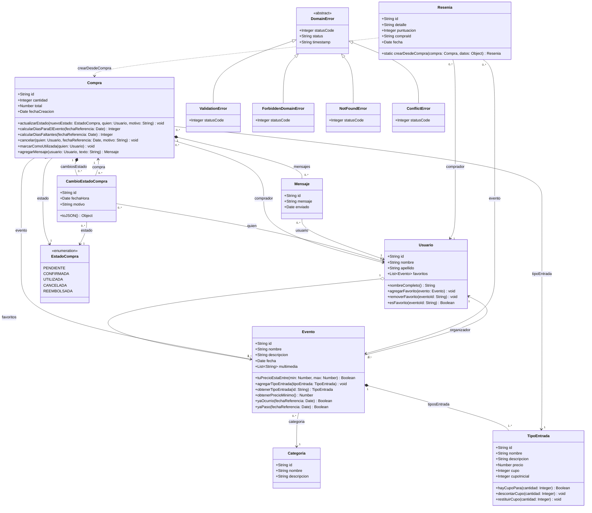

# 📐 Diagrama de Clases UML — Modelo de Dominio

**AI Ticket It — Plataforma de Publicación de Eventos y Venta de Entradas**  
**Cátedra:** Desarrollo de Software — Trabajo Práctico Individual (UTN FRBA)

---

## 1. Diagrama de Clases UML (Mermaid)

---

## 2. Detalle de Entidades y Responsabilidades

### 👤 `Usuario`
Representa tanto a compradores finales como a productores/organizadores de eventos.
* **Atributos:**
  * `id`: Identificador único.
  * `nombre`, `apellido`: Datos identificatorios.
  * `favoritos`: Colección de eventos marcados como favoritos por el usuario.
* **Comportamiento:**
  * `nombreCompleto`: Getter de conveniencia para la presentación (`${nombre} ${apellido}`).
  * `agregarFavorito(evento)` / `removerFavorito(eventoId)` / `esFavorito(eventoId)`: Gestión de la lista de deseos sin duplicados.

### 🏷️ `Categoria`
Clasificación temática de los eventos (ej. Recitales, Teatro, Deportes, Tecnología).
* **Atributos:** `id`, `nombre`, `descripcion`.

### 🎟️ `TipoEntrada`
Define la tipología de acceso a un evento con precio diferenciado y control estricto de cupo (*stock*).
* **Atributos:**
  * `id`, `nombre`, `descripcion`.
  * `precio`: Valor monetario unitario.
  * `cupo`: Cupo disponible remanente.
  * `cupoInicial`: Capacidad máxima original para cálculo de porcentaje de ocupación.
* **Comportamiento (Experto en Cupos):**
  * `hayCupoPara(cantidad)`: Verifica si `cupo >= cantidad`.
  * `descontarCupo(cantidad)`: Reduce el cupo disponible. Lanza `ConflictError` si no alcanza.
  * `restituirCupo(cantidad)`: Incrementa el cupo ante cancelaciones o reembolsos.

### 🎪 `Evento`
Entidad raíz del catálogo y la publicación.
* **Atributos:**
  * `id`, `nombre`, `descripcion`, `fecha` (objeto `Date`), `multimedia` (URLs), `categoria` (`Categoria`), `organizador` (`Usuario`), `tiposEntrada` (`TipoEntrada[]`).
* **Comportamiento:**
  * `tuPrecioEstaEntre(min, max)`: Evalúa si alguna de sus tarifas se encuentra dentro del rango consultado.
  * `agregarTipoEntrada(tipoEntrada)`: Incorpora nuevas localidades.
  * `obtenerTipoEntrada(id)`: Busca y devuelve la entrada correspondiente o arroja `NotFoundError`.
  * `obtenerPrecioMinimo()`: Determina la tarifa base para mostrar en tarjetas del catálogo.
  * `yaOcurrio(fechaReferencia)` / `yaPaso(fechaReferencia)`: Determina si el evento ya se llevó a cabo.

### 💳 `Compra`
Transacción y contrato comercial entre un comprador y un evento.
* **Atributos:**
  * `id`, `comprador` (`Usuario`), `evento` (`Evento`), `tipoEntrada` (`TipoEntrada`), `cantidad`, `total`, `estado` (`EstadoCompra`), `mensajes` (`Mensaje[]`), `cambiosEstado` (`CambioEstadoCompra[]`), `fechaCreacion`.
* **Comportamiento (Patrón Experto de Información y State Machine):**
  * Al instanciarse, valida y descuenta automáticamente el cupo mediante `tipoEntrada.descontarCupo(cantidad)`.
  * `actualizarEstado(nuevoEstado, quien, motivo)`: Transiciona el estado y registra una auditoría inmutable en `cambiosEstado`.
  * `cancelar(quien, fechaReferencia, motivo)`: Valida permisos (solo comprador u organizador), verifica que la entrada no haya sido `UTILIZADA`, que no esté cancelada previamente y que el evento no haya ocurrido. Restituye el cupo (`tipoEntrada.restituirCupo(cantidad)`) y pasa a `CANCELADA`.
  * `marcarComoUtilizada(quien)`: Transiciona la entrada de `CONFIRMADA` a `UTILIZADA` en el control de acceso del evento.
  * `calcularDiasParaElEvento(fechaReferencia)` / `calcularDiasFaltantes()`: Solo operable en estado `CONFIRMADA`; calcula la diferencia en días calendario.
  * `agregarMensaje(usuario, texto)`: Control de chat entre partes habilitadas (comprador u organizador).

### 🕒 `CambioEstadoCompra`
Registro histórico de auditoría (*Audit Trail*) para cada transición de estado en una compra.
* **Atributos:** `id`, `compra`, `estado`, `quien` (`Usuario`), `fechaHora`, `motivo`.
* **Comportamiento:**
  * `toJSON()`: Serializador personalizado que rompe la referencia circular con `Compra`, devolviendo `compraId: this.compra?.id`.

### 💬 `Mensaje`
Unidad de comunicación del chat de soporte contextual de la compra.
* **Atributos:** `id`, `usuario` (`Usuario`), `mensaje` (texto), `enviado` (`Date`).

### ⭐ `Resenia`
Calificación y feedback otorgado por el comprador luego de asistir a un evento.
* **Atributos:** `id`, `comprador` (`Usuario`), `evento` (`Evento`), `detalle`, `puntuacion` (entero de 1 a 5), `compraId`, `fecha`.
* **Comportamiento:**
  * `crearDesdeCompra(compra, datos)`: Método de fábrica estático (*Factory Method*). Valida que la compra esté en estado `UTILIZADA` antes de permitir la calificación.

---

## 3. Justificación de Tipos de Relaciones

| Relación | Tipo UML | Justificación de Diseño |
| :--- | :--- | :--- |
| `Evento` ➔ `TipoEntrada` | **Composición (`*--`)** | Las localidades (`TipoEntrada`) no tienen ciclo de vida independiente fuera del `Evento` que las contiene. Si el evento desaparece, sus tipos de entrada no existen por sí solos. |
| `Compra` ➔ `CambioEstadoCompra` | **Composición (`*--`)** | Los registros históricos de auditoría pertenecen exclusivamente al ciclo de vida de esa `Compra`. |
| `Compra` ➔ `Mensaje` | **Composición (`*--`)** | El hilo de chat vive contenido en el contexto exclusivo de la `Compra`. |
| `Usuario` ➔ `Evento` (favoritos) | **Agregación (`o--`)** | Los eventos existen independientemente de que un usuario los agregue o los quite de su lista de favoritos. |
| `Evento` ➔ `Categoria` | **Asociación dirigida (`-->`)** | El evento conoce a su categoría para clasificar el catálogo. |
| `Evento` ➔ `Usuario` (organizador) | **Asociación dirigida (`-->`)** | El evento referencia a su usuario productor. |
| `Compra` ➔ `Evento`, `Usuario`, `TipoEntrada` | **Asociación dirigida (`-->`)** | La compra referencia a las entidades que interactúan en la transacción. |
| `Resenia` ➔ `Compra` | **Dependencia (`..>`)** | El método estático `crearDesdeCompra` depende temporalmente del estado de la compra para validar la elegibilidad del testimonio. |

---

## 4. Archivos Generados en `/assets`

1. **`diagrama-clases-dominio.md`**: Este documento con diagrama interactivo Mermaid.
2. **`diagrama-clases-dominio.puml`**: Especificación en código PlantUML estándar.
3. **`diagrama-clases-dominio.svg`**: Gráfico vectorial escalable renderizado.
4. **`diagrama-clases-dominio.png`**: Imagen de alta resolución para reportes e impresiones.
